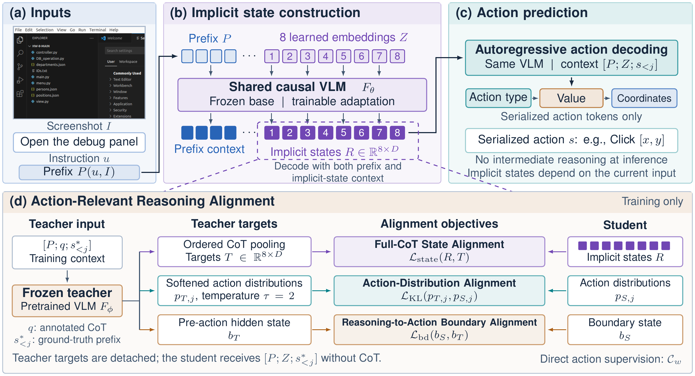

# RISE: Reasoning with Implicit State Embeddings for GUI Agents



RISE uses eight learned implicit states to condition GUI action generation without generating intermediate reasoning text. Full supervision combines action learning with reasoning-state, action-distribution and reasoning-to-action boundary alignment.

[Paper](https://arxiv.org/abs/2611.32102) | [Model weights](https://huggingface.co/L1007555652/RISE)

## Setup

Use Python 3.10 or newer and a CUDA-compatible PyTorch installation.

```bash
pip install -r requirements.txt
python download_weights.py
```

The private weights repository requires Hugging Face authentication. `RISE.pt` contains LoRA adapters and eight implicit-state embeddings. Load it with `mPLUG/GUI-Owl-1.5-8B-Instruct`, configured in `configs/guiowl.json`.

## Evaluation

```bash
python evaluate.py --config configs/guiowl.json --checkpoint weights/RISE.pt \
  --benchmark osworldg --data data/osworldg.jsonl --output outputs/osworldg.jsonl
python evaluate.py --config configs/guiowl.json --checkpoint weights/RISE.pt \
  --benchmark screenspot --data data/screenspot.jsonl --output outputs/screenspot.jsonl
```

Grounding uses the native GUI-Owl tool-call prompt and parses normalized coordinates, including decimal values. OSWorld-G refusal predictions are scored explicitly; malformed outputs count as errors. Evaluate refined instructions with the same checkpoint and original image geometry.

Use `--benchmark action` for complete-action generation. Native-format inputs must include the appropriate `system` prompt. Predictions include raw tool calls, output-token counts and inference latency. Use the official AC-v2 or MM-Mind2Web-v2 scorer for complete-action accuracy.

For parallel evaluation, run one process per GPU with distinct `CUDA_VISIBLE_DEVICES`, `--shard`, `--num-shards` and output paths. Existing output files are never overwritten.

## Training

```bash
# Action supervision with native GUI-Owl outputs
torchrun --standalone --nproc_per_node=8 train.py --config configs/guiowl.json \
  --data data/native.jsonl --batch-size 32 --output outputs/action

# Full supervision with Qwen3-VL
torchrun --standalone --nproc_per_node=4 train.py --config configs/qwen.json \
  --data data/train.jsonl --batch-size 256 --output outputs/full
```

Both configurations freeze pretrained base parameters and optimize LoRA adapters and eight implicit embeddings. Full supervision uses teacher reasoning only during training.

`--init` loads model parameters from a compatible checkpoint for further adaptation; it does not restore optimizer state. Intermediate checkpoints are saved every 500 updates by default.

## Data

Inputs are JSONL records with `id`, `image` and `instruction` (or `user`). Image paths are local paths; retain interaction history in the instruction text.

- Grounding evaluation requires `image_size: [width,height]`. ScreenSpot additionally uses `bbox_xyxy_original: [left,top,right,bottom]` in original pixels. OSWorld-G uses `box_type` (`bbox`, `polygon` or `refusal`) and original `box_coordinates`; bbox entries are `[left,top,width,height]`.
- Native training records contain `system` and `target`, preserving the backbone's tool-call prompt and serialized action. Optional `weight` controls example weighting.
- Qwen action-format training records contain `action: {"action_type": "Click", "value": "None", "point_2d": [420,360]}`. Full supervision additionally requires nonempty teacher reasoning in `cot`. Coordinates use `[0,1000]`.

The original datasets and teacher annotations are not bundled. Keep training and evaluation trajectories separate. Image budgets and supervision mode are configured in `configs/`.
